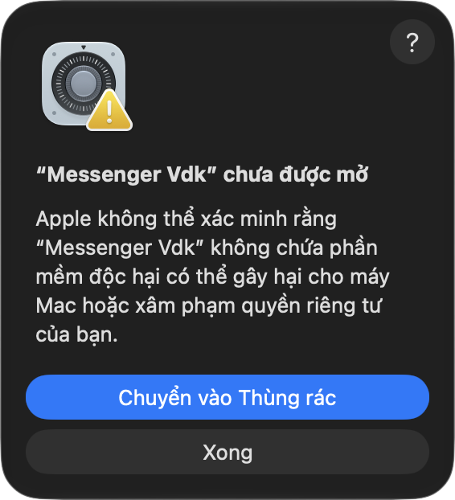

# Messenger Vdk

App Messenger gọn nhẹ cho macOS (chip Apple), viết bằng Swift + WKWebView. Chỉ **~1,2 MB** (bản Electron gốc ~241 MB).

> ⚠️ App **không chính thức**, không liên quan tới Meta. App chỉ mở trang **messenger.com** chính thức trong một cửa sổ riêng – đăng nhập, tin nhắn, cuộc gọi đi thẳng tới máy chủ Meta như khi dùng trình duyệt. App **không gửi dữ liệu đi đâu khác**, không thu thập thông tin người dùng.

## Tính năng
- **Thông báo tin nhắn** khi bạn ở app khác (cả tin nhóm). Dock chỉ nảy khi có cuộc gọi.
- **Bảng nổi cuộc gọi đến**: phân biệt gọi thoại / video / gọi nhóm (kèm tên nhóm), bấm Từ chối / Chấp nhận ngay trên bảng. Gác máy là tắt chuông.
- **Cuộc gọi**: chia sẻ màn hình, tự thu nhỏ thành cửa sổ nổi (PiP) khi chuyển app, ⇧⌘P.
- **Tải ảnh / file**: hỏi lưu vào đâu (hoặc lưu thẳng một thư mục), giữ độ phân giải gốc.
- **Phím tắt**: ⌘N tin nhắn mới · ⌘1–9 mở đoạn chat · ⌘F / ⇧⌘F tìm · ⌘S ẩn/hiện thông tin cuộc trò chuyện · ⇧⌘S ẩn/hiện thanh bên · ⌘/ bảng phím tắt.
- **Cài đặt (⌘,)**: thông báo, cuộc gọi, tải file, mở cùng máy, nhật ký gỡ lỗi.
- Giữ đăng nhập, chỉ chạy 1 bản, giao diện tiếng Việt.

## Cài đặt
Yêu cầu: macOS 14 trở lên, chip Apple (M1/M2/M3…).

1. Tải **`Messenger.Vdk.0.6.0.dmg`** ở mục **[Releases](../../releases/latest)** (hoặc file `.zip`).
2. Bấm đúp file DMG → kéo **Messenger Vdk** vào thư mục **Applications**.
3. Mở app lần đầu: macOS sẽ chặn vì app **chưa được Apple công chứng** (notarize – cần gói Apple Developer trả phí). Hộp cảnh báo chỉ có nút «Chuyển vào Thùng rác» và «Xong» → bấm **Xong**.

   

4. Mở **Cài đặt hệ thống → Quyền riêng tư & Bảo mật** → kéo xuống mục **Bảo mật**, thấy dòng *«"Messenger Vdk" đã bị chặn để bảo vệ máy Mac của bạn.»* → bấm **Vẫn mở** → nhập mật khẩu máy.
5. Mở lại app (nếu macOS hỏi lại thì bấm **Mở**). Từ lần sau mở bình thường.

> Từ macOS 15, cách «chuột phải → Mở» **không còn** bỏ qua được cảnh báo – phải làm bước 4.
> Dùng Terminal (nhanh hơn, chỉ khi bạn tin app này): `xattr -dr com.apple.quarantine "/Applications/Messenger Vdk.app"`

Gỡ cài đặt: thoát app → kéo `Messenger Vdk.app` trong Applications vào Thùng rác. Gỡ app không xoá đăng nhập; muốn xoá sạch thì xoá thêm `~/Library/WebKit/com.vduck.messenger`, `~/Library/HTTPStorages/com.vduck.messenger*` và `~/Library/Logs/Messenger Vdk`.

Bộ gõ tiếng Việt: bộ gõ Apple chạy ngay. VietTelex: thêm app (bundle id `com.vduck.messenger`) vào bảng cơ chế gõ → **Gõ trực tiếp**.

## Tự build
```bash
bash build.sh
```
Ra `Messenger Vdk.app` trong `$TMPDIR/vduck-messenger-build`. Cần Xcode Command Line Tools. Ký app: đặt mã chứng chỉ vào biến `KY_APP` hoặc file `.ky-app`; không có thì ký tạm (ad-hoc).

Mã nguồn: `Ma nguon/main.swift` (toàn bộ app, chú thích tiếng Việt).

## Ghi công
Ý tưởng từ **MessengerApp** của Stefan – [stefanminch/messenger-mac](https://github.com/stefanminch/messenger-mac) (MIT). Bản này viết lại từ đầu bằng Swift. Giấy phép: [MIT](LICENSE).

© 2026 by Vduck
